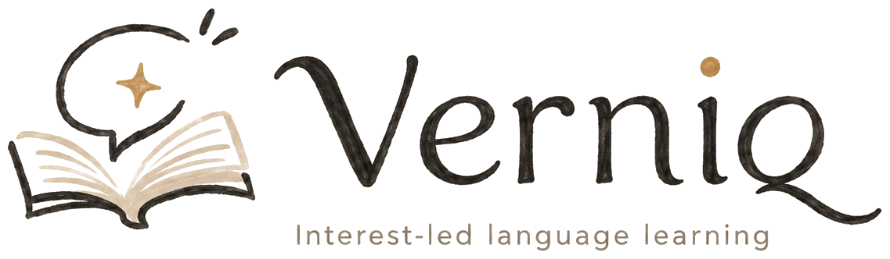
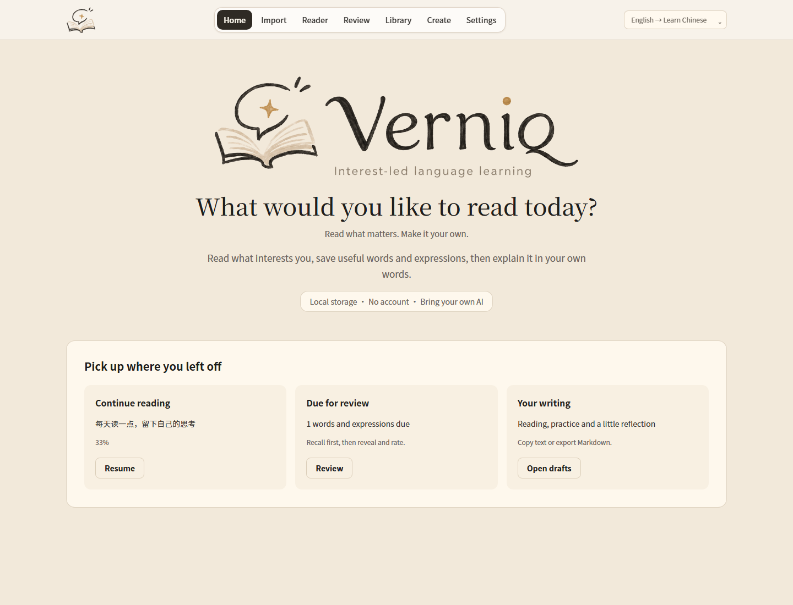
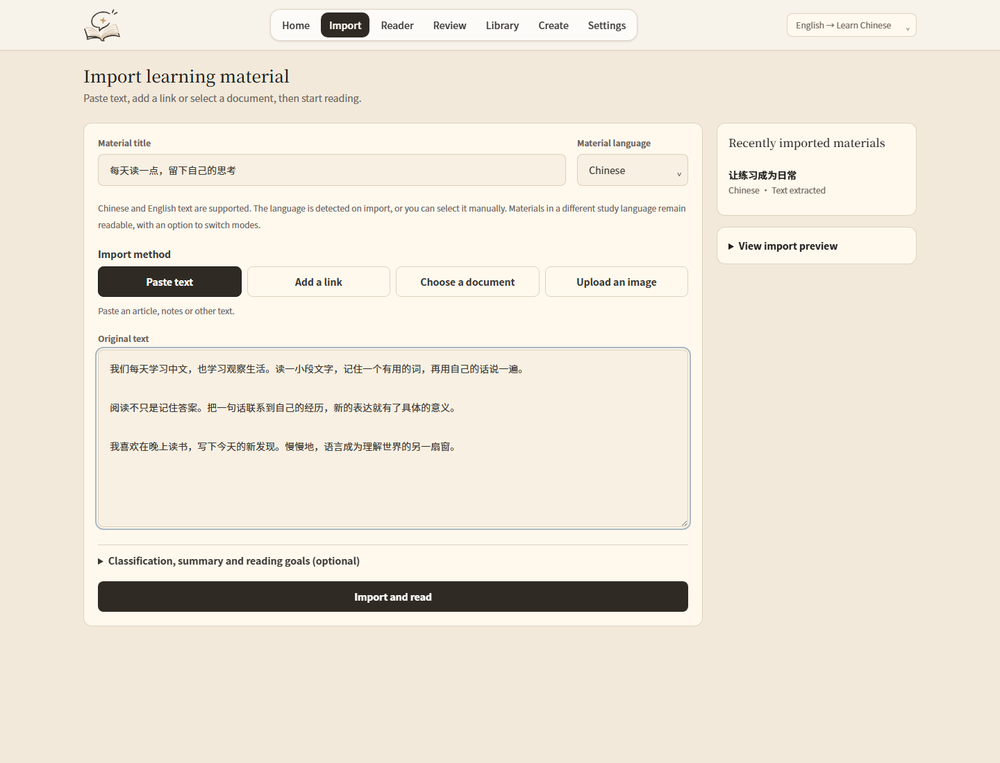
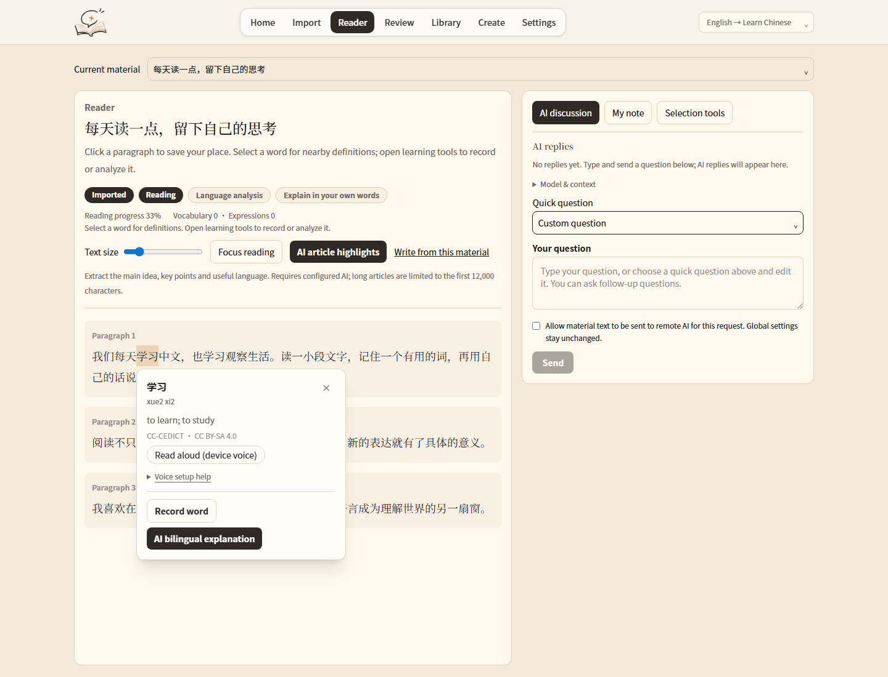
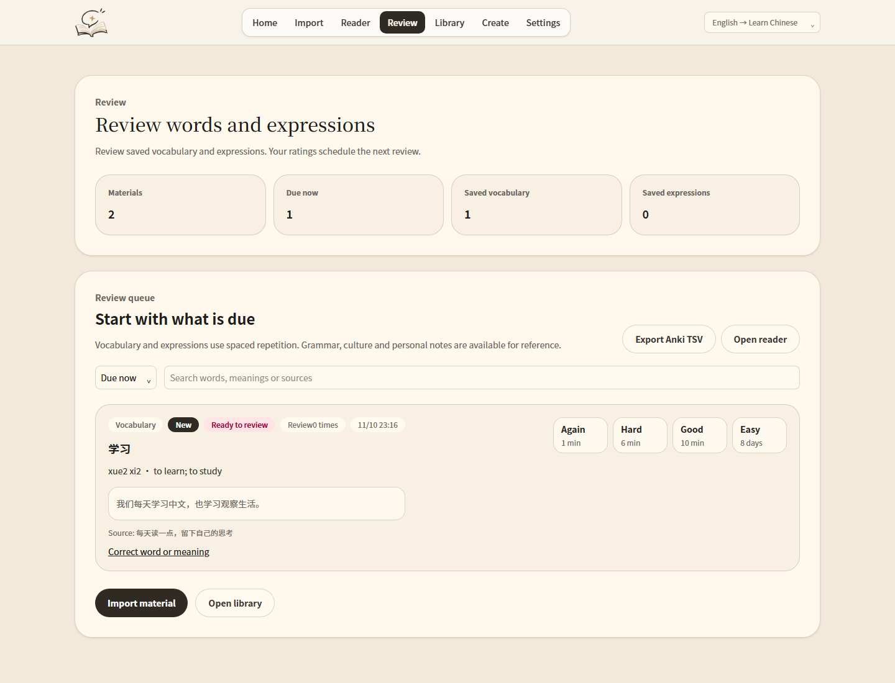
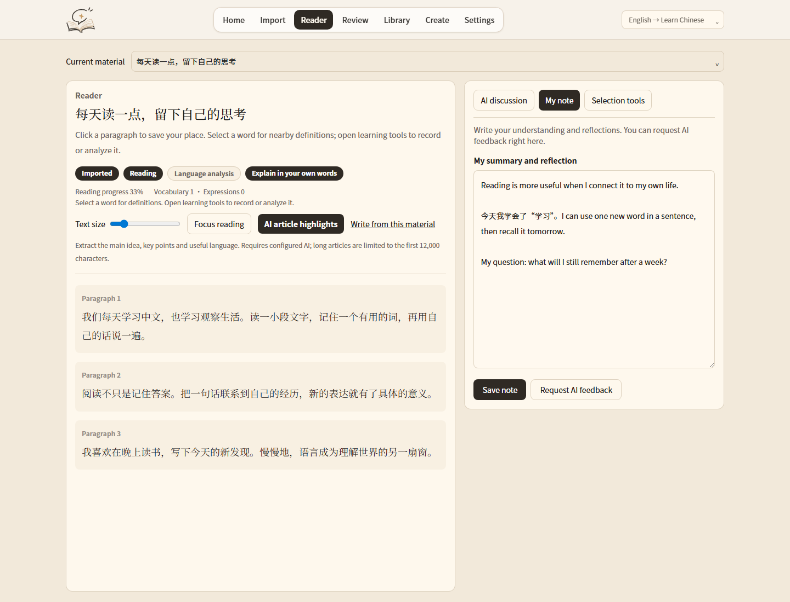
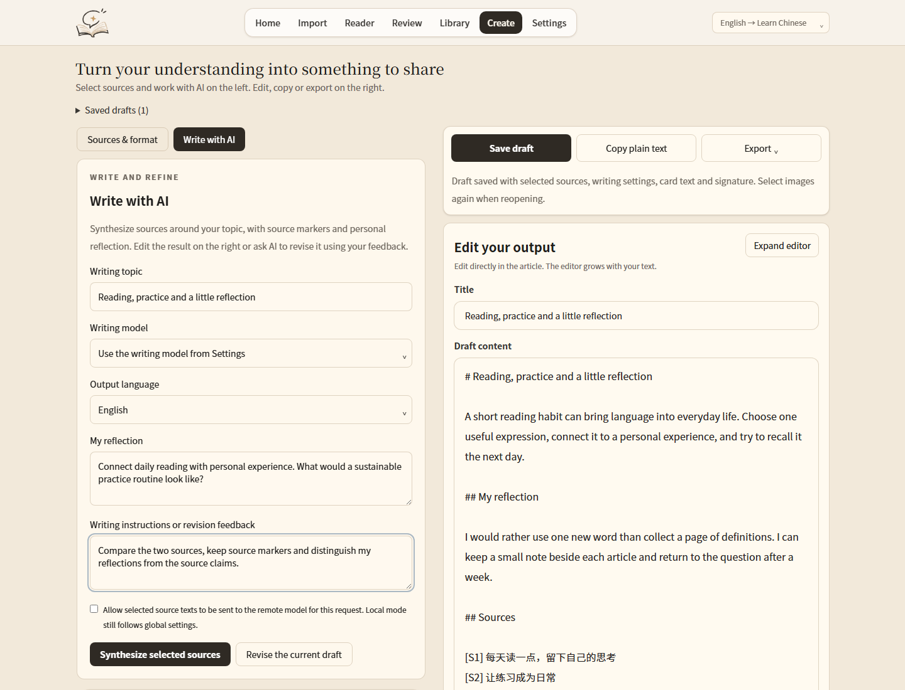
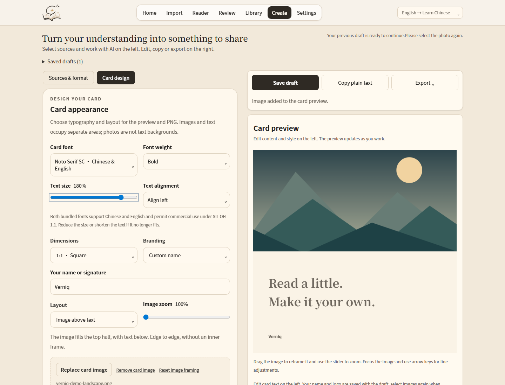
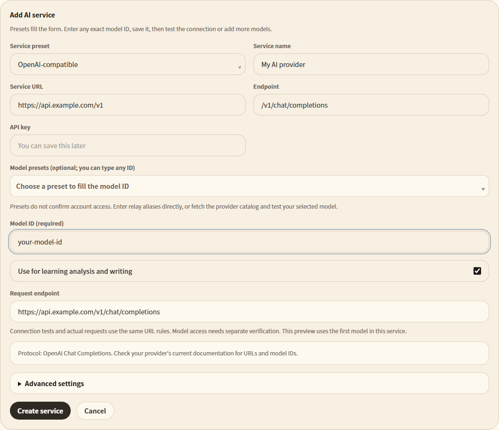

<p align="center"></p>

<p align="center"><strong>Read what interests you. Make it your own.</strong><br>从感兴趣的材料出发，读懂、记住，再写出自己的理解。</p>

<p align="center"><a href="README.zh-CN.md">简体中文</a> · <strong>English</strong> · <a href="LICENSE">Apache-2.0</a> · <a href="docs/SCREENSHOTS.md">Screenshots / 界面图集</a></p>

Verniq is a **local-first Chinese and English learning workspace**. Bring your
own reading materials, look up language in context, review what you save, and
turn sources and reflections into writing. AI is optional and uses your own
provider and API key.

**Status: early testing release, version 0.1.0.** Source and production-web checks
exist; a signed, independently verified desktop installer is not yet published.



## From reading to your own writing

| Step | What you can do |
| --- | --- |
| Import | Paste text, extract a webpage, or import TXT, Markdown, HTML, PDF and DOCX. Image text extraction requires a configured image-capable AI model; scanned PDFs need OCR. |
| Read | Select a word to open a nearby bilingual dictionary popup. Save vocabulary and expressions with their source context. Device pronunciation depends on installed system voices. |
| Reflect | Keep your own notes beside the original. With AI configured, ask follow-up questions, extract article highlights, discuss a selection or request feedback. |
| Review | Recall before revealing the answer, then rate it to update the FSRS schedule. Correct entries and export Anki TSV. |
| Create | Select one or more sources and add a theme, instructions and your reflection. AI can synthesize or revise a draft; edit the result yourself before sharing. |
| Share | Copy plain text or Markdown, download Markdown, or design a short quote card with typography, optional imagery and your own attribution. Export cards as PNG. |

Switch between **Chinese UI → learning English** and **English UI → learning
Chinese**. Materials keep their own language and learning records. ECDICT and
CC-CEDICT are bundled for local lookup; online dictionary services are optional.

## A closer look

These are real production-web screenshots using original sample materials.
No private workspace, API keys or simulated AI answers are shown.
See the [bilingual gallery](docs/SCREENSHOTS.md) for both interface languages.

| Import your material | Look up words in context |
| --- | --- |
|  |  |

| Recall and review | Keep your own understanding |
| --- | --- |
|  |  |

| Sources and writing | A short, editable share card |
| --- | --- |
|  |  |



## Run locally

Install Node.js 22 and npm, then:

```sh
git clone https://github.com/BlueVenn6/verniq.git
cd verniq
npm ci
npm run build
npm run serve:out
```

Open **http://127.0.0.1:3000**. Development mode is `npm run dev`.
Without AI you can import, read, look up words, take notes, review and export.

Windows desktop development also needs Rust's stable MSVC toolchain, Visual
Studio C++ Build Tools and WebView2. See the [build guide](docs/BUILD_AND_RELEASE.md).
A desktop release build is separate from the web preview.

## Connect your own AI

1. Open **Settings → AI settings** and expand the setup guide if needed.
2. Choose a provider or compatible relay. Enter its API base URL, protocol,
   your API key and the provider's exact model ID.
3. Verify that model, then assign it to reading or writing. Presets and server
   catalog visibility do not prove that your account can call a model.
4. Verify image input separately for OCR. Image understanding and image generation
   are different capabilities and may use different endpoints.

Remote requests may incur your provider's charges. There is no shared API quota,
hosted account, payment balance or automatic social-platform publishing.
Local models depend on your installed service and its capabilities.

## Data and privacy

- Web data lives in browser storage. Clearing browser data can remove it; export
  backups regularly. Browser API keys are kept for the current session.
- Desktop uses local workspace files and the available OS credential store.
  Older files may contain legacy credentials; treat them as private and read
  the [data handling notes](docs/PRIVACY.md).
- AI sends the requested material, context or images to your chosen provider.
  Online dictionary audio and URL imports also contact external services.
- Source indexes help you return to materials. They do not independently verify
  facts, quotations or permission to redistribute a source.

## Development and verification

```sh
npm run lint
npm run typecheck
npm test -- --maxWorkers=1
npm run build
npm run test:production
```

Production checks need Playwright Chromium (`npx playwright-core install chromium`)
or local Edge on Windows. CI checks web flows and native Rust tests. These
checks do not replace testing the exact installed desktop package.

The only source tree is this repository: `app/` and `src/` build into `out/`;
Tauri packages that output through `src-tauri/`. Generated `build/`, `.next/`
and `src-tauri/target/` are not alternate sources.

## License and project information

- Application code: [Apache-2.0](LICENSE), maintained by Nera Venn.
- Dictionaries, fonts and dependencies: [third-party notices](THIRD_PARTY_NOTICES.md).
- Security reporting: [SECURITY.md](SECURITY.md). Never post keys or private materials.
- Build steps and artifact provenance: [build guide](docs/BUILD_AND_RELEASE.md).
- Bugs and suggestions: [GitHub Issues](https://github.com/BlueVenn6/verniq/issues).

There is currently no official signed installer or SignPath sponsorship claim.
Only trust release files explicitly identified by the maintainer and their hashes.
