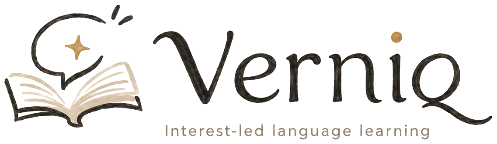
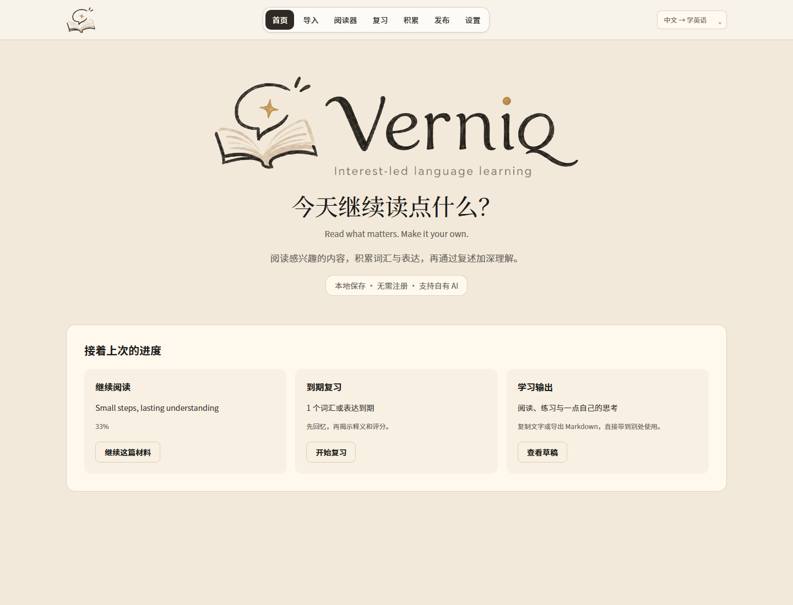
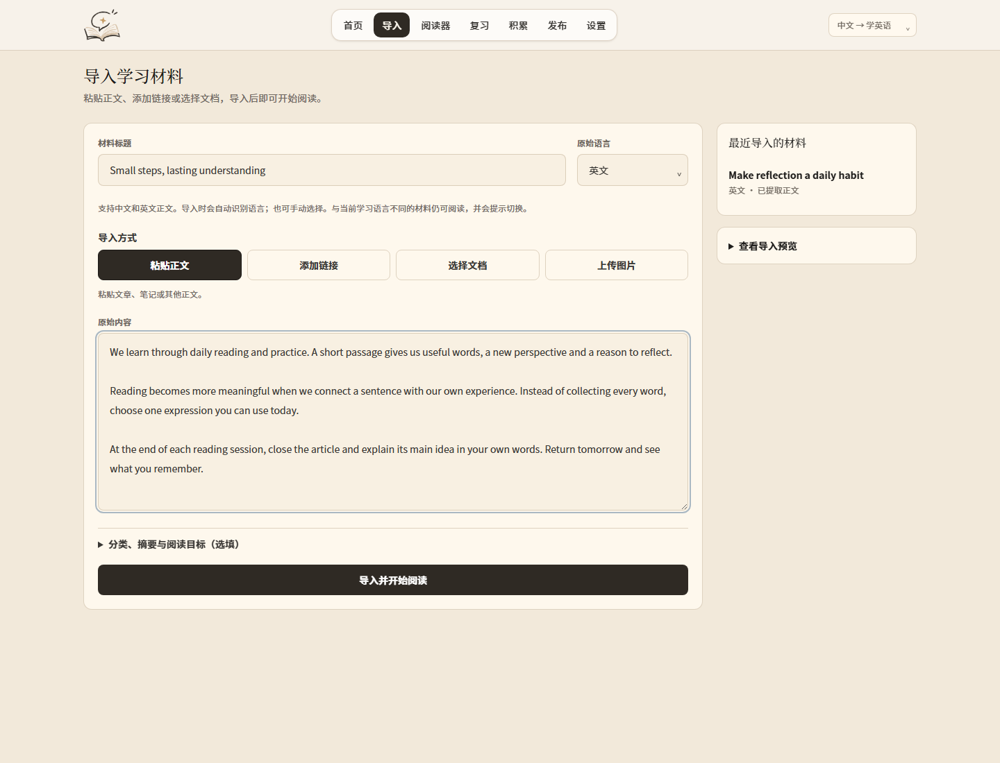
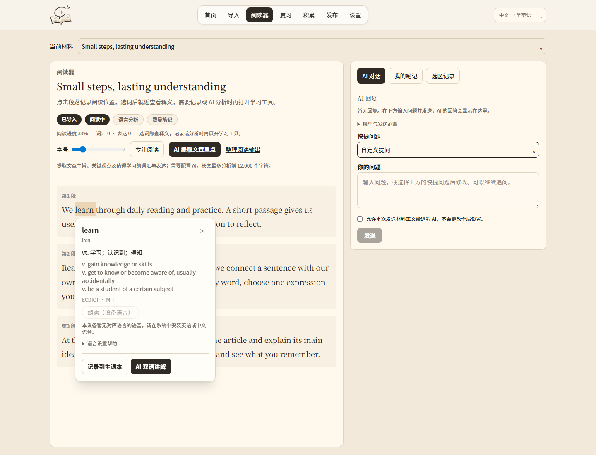
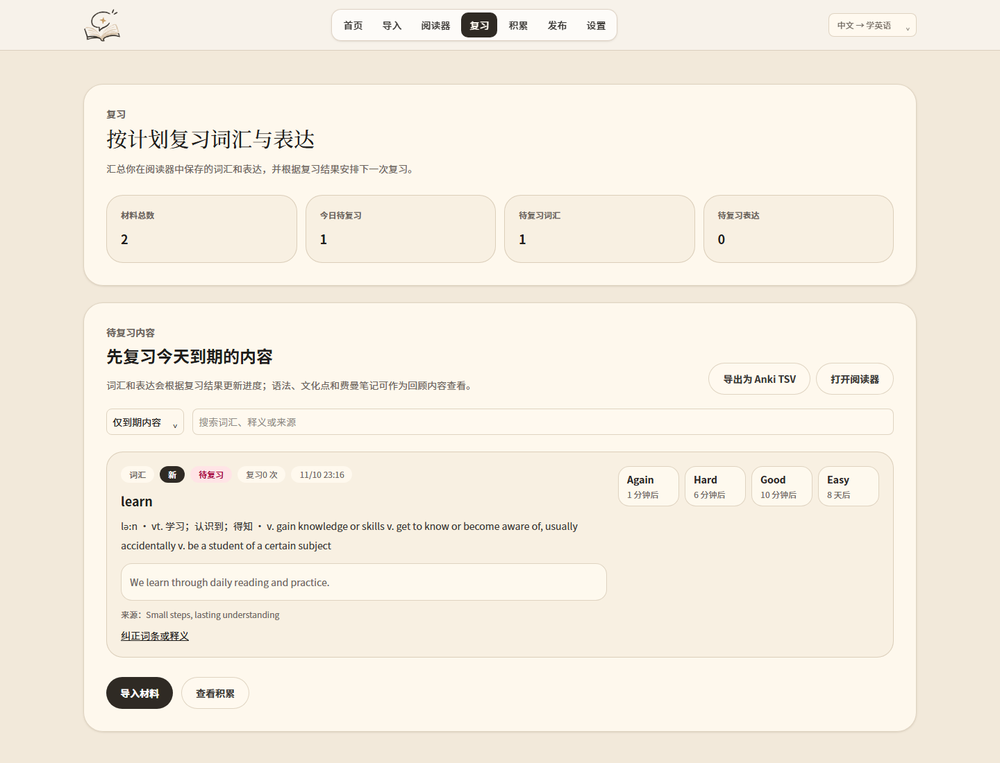
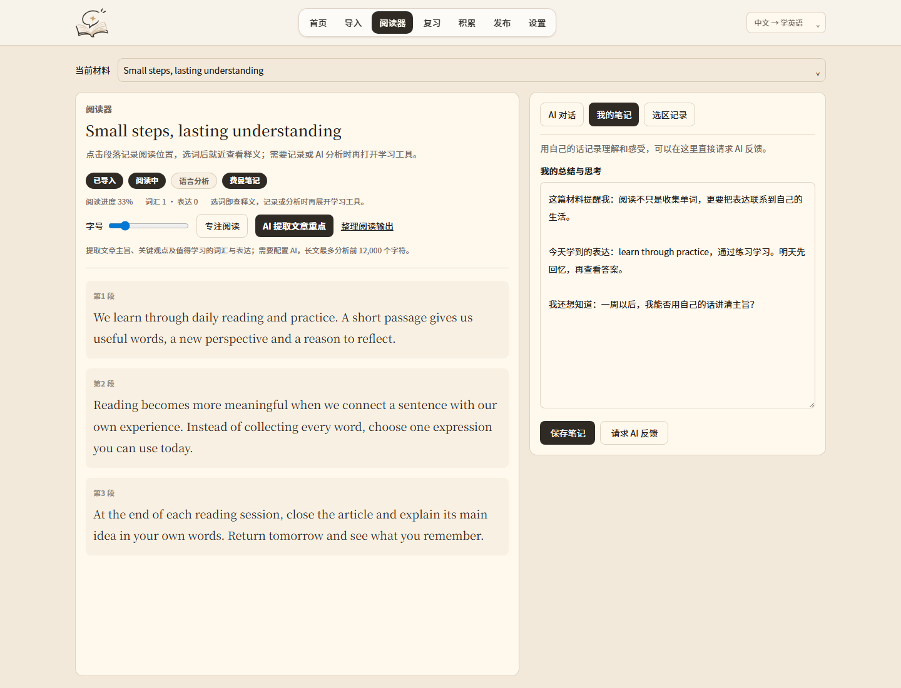
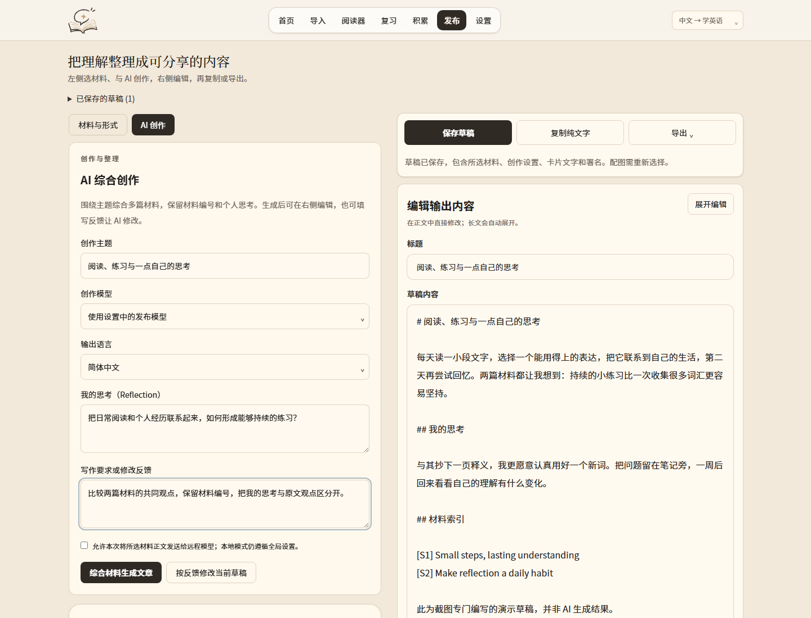
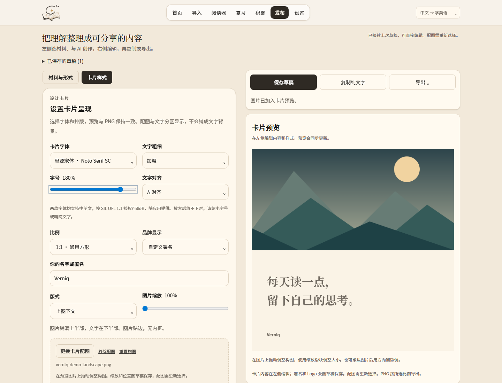
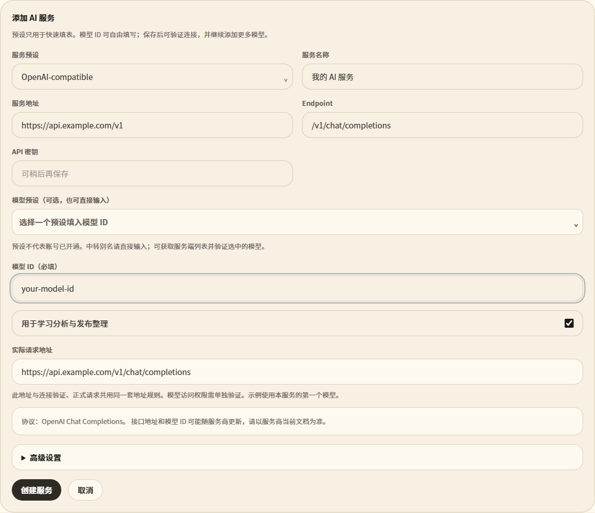

<p align="center"></p>

<p align="center"><strong>从感兴趣的材料出发，读懂、记住，再写出自己的理解。</strong><br>Read what interests you. Make it your own.</p>

<p align="center"><strong>简体中文</strong> · <a href="README.md">English</a> · <a href="LICENSE">Apache-2.0</a> · <a href="docs/SCREENSHOTS.md">中英界面图集</a></p>

Verniq 是一个**本地优先的中英语言学习工作台**。导入自己想读的材料，在上下文中查词、
积累与复习，再把材料和个人思考整理成自己的文字。AI 是可选辅助，使用你自行配置的
服务商和 API 密钥。

**当前为早期测试版本 0.1.0。** 项目有源码和生产网页检查，但尚未发布经过独立安装验证
的签名桌面安装包，不宣称已达到成熟商业交付标准。



## 从阅读到自己的表达

| 环节 | 可以做什么 |
| --- | --- |
| 导入 | 粘贴正文、提取网页，或导入 TXT、Markdown、HTML、PDF、DOCX。图片文字提取需要配置支持图片输入的 AI；扫描 PDF 需要 OCR。 |
| 阅读 | 选词后就近打开双语释义，保存词汇、表达和来源上下文。设备朗读取决于系统已安装的语言语音。 |
| 思考 | 在原文旁写自己的笔记；配置 AI 后，可追问、提取文章重点、解释选句或请求反馈。 |
| 复习 | 先回忆再揭示答案，评分后更新 FSRS 复习时间；支持纠错和 Anki TSV 导出。 |
| 创作 | 选择一篇或多篇材料，加入主题、要求和个人思考，让 AI 综合或修改草稿，再由自己编辑。 |
| 分享 | 复制纯文字或 Markdown、下载 Markdown；把短句或观点设计成分享卡片，调整字体、配图与署名，导出 PNG。 |

支持**中文界面学英语**和**英文界面学中文**。材料保留各自的语言和学习记录。
内置 ECDICT 与 CC-CEDICT 本地查词，在线词典可按需使用。

## 功能截图

以下均为当前生产网页和原创示例材料的真实截图，不包含私人工作区、API 密钥或伪造的
AI 回答。[中英对照图集](docs/SCREENSHOTS.md)包含两种界面的完整配图与说明。

| 导入自己的材料 | 在上下文中查词 |
| --- | --- |
|  |  |

| 回忆与复习 | 写下自己的理解 |
| --- | --- |
|  |  |

| 从材料到创作 | 短内容分享卡片 |
| --- | --- |
|  |  |



## 本地运行

安装 Node.js 22 与 npm 后执行：

```sh
git clone https://github.com/BlueVenn6/verniq.git
cd verniq
npm ci
npm run build
npm run serve:out
```

浏览器打开 **http://127.0.0.1:3000**。开发模式使用 `npm run dev`。
不配置 AI 也能导入、阅读、查词、做笔记、复习与导出。

Windows 桌面开发还需要 Rust stable MSVC 工具链、Visual Studio C++ Build Tools 和
WebView2，详见[构建与发布说明](docs/BUILD_AND_RELEASE.md)。网页预览与桌面打包是不同步骤。

## 使用自己的 AI

1. 打开**设置 → AI 设置**，需要时展开首次配置说明。
2. 选择原生服务或兼容中转，填写 API 服务地址、正确协议、密钥和服务商提供的准确模型 ID。
3. 验证模型，再为阅读或创作分配模型。预设名称、服务端列表可见，都不等于账户实际可调用。
4. OCR 需要单独验证图片输入。看图理解与图片生成是两种能力，可能使用不同接口。

远程调用可能产生你所选服务商的费用。当前没有托管账户、共享额度、充值余额或社交平台自动
发布服务；本地模型的可用性取决于你安装的服务和模型能力。

## 数据与隐私

- 网页版数据保存在浏览器中；清理浏览器数据可能删除记录，请定期导出备份。网页密钥保留于当前会话。
- 桌面版使用本地工作区文件和可用的系统凭据库。旧文件可能仍含历史明文凭据，请按私人文件保管，参阅[数据处理说明](docs/PRIVACY.md)。
- AI 会把当前任务所需材料、上下文或图片发给你选择的服务商；在线词典音频、网页导入也会连接相应外部服务。
- 材料索引帮助回看来源，不代表已经核实事实、引用准确性或再分发授权。

## 开发与检查

```sh
npm run lint
npm run typecheck
npm test -- --maxWorkers=1
npm run build
npm run test:production
```

生产浏览器测试需要 Playwright Chromium（`npx playwright-core install chromium`），
或 Windows 上可用的本地 Edge。CI 检查网页流程和 Rust 原生测试；它们不能代替实际安装
最终桌面包并检查恢复、升级等行为。

唯一源码是本仓库：`app/`、`src/` 构建到 `out/`，Tauri 从 `src-tauri/` 打包该输出。
`build/`、`.next/`、`src-tauri/target/` 是生成物，不是其他工作树。

## 许可与项目资料

- 应用代码：[Apache-2.0](LICENSE)，维护者 Nera Venn。
- 词典、字体与依赖：[第三方许可说明](THIRD_PARTY_NOTICES.md)。
- 安全报告：[SECURITY.md](SECURITY.md)，请勿在公开 Issue 中提交密钥或私人材料。
- 构建步骤、产物来源与验证范围：[构建说明](docs/BUILD_AND_RELEASE.md)。
- 问题与建议：[GitHub Issues](https://github.com/BlueVenn6/verniq/issues)。

目前没有官方签名安装包，也未宣称获得 SignPath 赞助。后续仅以维护者明确标识、附带哈希的
发行文件为准。
